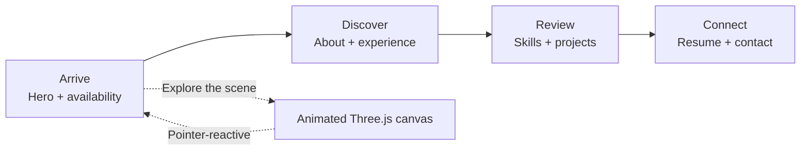
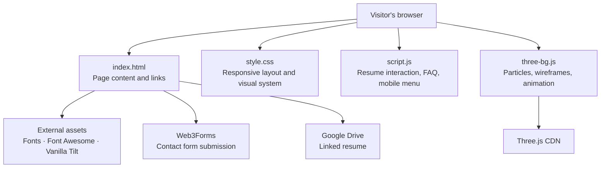

<div align="center">

# Ojaswa Srivastava
### Data Science · AI / Machine Learning · Interactive 3D

**A dark, immersive portfolio where data-driven work meets a living, interactive canvas.**

[](https://developer.mozilla.org/docs/Web/HTML)
[](https://developer.mozilla.org/docs/Web/CSS)
[](https://developer.mozilla.org/docs/Web/JavaScript)
[](https://threejs.org/)

[Explore the portfolio](#-explore-the-portfolio) · [Run locally](#-run-locally) · [Make it yours](#-make-it-yours)

</div>

---

## ✦ At a glance

This is a responsive, single-page portfolio for **Ojaswa Srivastava**, presenting a professional profile across data science, analytics, and AI/ML. Its visual identity pairs glass-style panels and neon gradients with a Three.js particle field, floating wireframes, and tilt-enabled cards.

| | |
|:--|:--|
| **Format** | Static HTML, CSS, and vanilla JavaScript |
| **3D layer** | Three.js — animated particles and wireframe geometry |
| **Interactions** | Pointer-reactive background, tilt cards, mobile navigation, FAQ accordion, resume file selection |
| **Contact** | Web3Forms submission endpoint |
| **Run requirement** | A modern browser; no build step or package installation |

## ✧ Explore the portfolio

The navigation takes visitors through the following sections:

| Section | What visitors find |
|:--|:--|
| **Home** | Availability, introduction, profile card, social links, and resume link |
| **About** | Career objective, technical philosophy, and areas of growth |
| **Experience** | Data Science Intern role and academic/open-source work |
| **Skills** | AI/ML, programming, data analysis, and engineering skill groups |
| **Resume** | Resume link and a browser-local file replacement control |
| **Projects** | RAG knowledge agent, LSTM stock prediction app, and ARIMA forecasting |
| **Help & FAQs** | Expandable answers about collaboration, the resume control, and expertise |
| **Contact** | Contact details, message form, and social profiles |

### The experience, in one glance



### What powers the page



> The portfolio itself has no application server or build pipeline. Contact form delivery and third-party assets rely on their external services being available.

## ◈ Featured work

### RAG-Based AI Knowledge Agent
An intelligent tutoring assistant that retrieves relevant course lecture transcripts and notes, then uses an LLM to explain concepts step by step.

**Tools:** Python · FFmpeg · Ollama · Whisper · vector embeddings  
**[View the project repository](https://github.com/Ojaswa05/RAG-Based-AI-Knowledge-Agent)**

### Stock Price Prediction Web App
A Streamlit application using historical AAPL data, MinMax scaling, and an LSTM model to forecast stock-price trends.

**Tools:** Python · Streamlit · TensorFlow/Keras · Scikit-learn · yfinance  
**[View the project repository](https://github.com/Ojaswa05/Stock-Price-Prediction-Web-App)**

### Time Series Forecasting Using ARIMA
An analysis and forecasting project exploring Italian electricity demand and solar generation data.

**Tools:** Python · ARIMA · Statsmodels · data visualization  
**[View the project repository](https://github.com/Ojaswa05/Time-Series-Forecasting-using-ARIMA)**

## ⚡ Run locally

There is no dependency installation or compilation step.

1. Download or clone this repository.
2. Open `index.html` in a modern browser.
3. For a local web-server preview, run `python -m http.server 8000` from the project directory and visit [http://localhost:8000](http://localhost:8000).

The local server is optional, but gives a closer preview of how the site behaves when hosted. An internet connection is needed for the CDN-hosted fonts, icons, Three.js, Vanilla Tilt, contact form, and linked resume.

## ⌘ Project map

```text
.
├── index.html          # Portfolio content, navigation, project cards, contact form
├── style.css           # Theme, layout, visual effects, responsive breakpoints
├── script.js           # Resume-file interaction, FAQ accordion, mobile menu
├── three-bg.js         # Three.js scene, geometry, pointer response, animation
├── image.jpg           # Profile image used in the hero card
├── sample-resume.txt   # Example text file for trying the resume control
└── README.md           # Project guide
```

## ✎ Make it yours

1. **Profile and copy** — edit the page content in `index.html`; replace `image.jpg` with your portrait, or change the image path on the profile ``.
2. **Projects and experience** — update the project cards, their repository links, skill tags, and experience timeline in `index.html`.
3. **Social and resume links** — replace the existing profile URLs and Google Drive resume URL in `index.html`.
4. **Contact form** — configure the form with your own Web3Forms access key. The form submits to Web3Forms; its key is present in client-side HTML, so treat it as public and configure service-side restrictions as appropriate.
5. **Colors and typography** — adjust the CSS custom properties near the top of `style.css`; the page's dark palette, cyan/blue/purple accents, and font choices are defined there.
6. **3D scene** — tune particle count, colors, object geometry, and animation in `three-bg.js`.

### Interaction notes

- The background animation uses WebGL. It responds to pointer movement and resizes with the browser window.
- Cards marked with `data-tilt` use the CDN-loaded Vanilla Tilt library.
- The FAQ accordion and mobile navigation are handled by `script.js`.
- Selecting a resume file updates the download link to a temporary browser object URL. **The file is not uploaded to a server or saved permanently**; selecting a new file or refreshing the page resets that local selection.
- The resume picker accepts PDF, Word, and text file extensions in its file dialog. This is a browser-side selection control, not a secure file-validation or upload service.
- The contact form submits visitor-provided details to the configured third-party form endpoint.

## ◉ Deploy

This is a static site: publish the project files together using any static hosting provider, such as GitHub Pages, Netlify, or Cloudflare Pages. Set the published site root to the directory containing `index.html`. No build command is required.

Before publishing, check that:

- `index.html`, `style.css`, `script.js`, `three-bg.js`, and `image.jpg` are deployed at the expected relative paths.
- Your own resume, social, project, and contact-form links are in place.
- External CDN resources and the Web3Forms endpoint are reachable from the deployed site.
- The page works at both desktop and mobile viewport sizes.

## ◇ Built with

| Layer | Technology |
|:--|:--|
| Markup | HTML5 |
| Styling | CSS3, responsive media queries, CSS custom properties |
| Interactions | Vanilla JavaScript |
| 3D graphics | Three.js `r128`, WebGL |
| Card motion | Vanilla Tilt `1.8.0` |
| Typography | Outfit and Space Grotesk via Google Fonts |
| Icons | Font Awesome `6.4.2` |
| Contact form | Web3Forms |

Third-party libraries, fonts, and icons are loaded from CDNs in `index.html`; there is no local package manifest.

---

<div align="center">

**Designed to make the work easy to explore — and the next conversation easy to start.**

[GitHub](https://github.com/Ojaswa05) · [LinkedIn](https://www.linkedin.com/in/ojaswa-srivastava-99b014324) · [Back to top](#ojaswa-srivastava)

</div>
